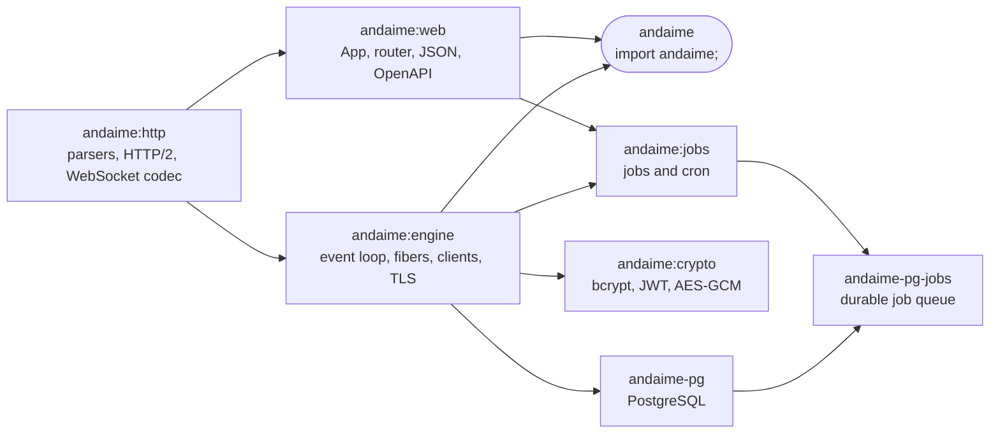

<div align="center">

# 🏗️ andaime

**A fast, modular, memory-safe web framework for D. Your function signature *is* your HTTP contract.**

[](https://github.com/leotada/andaime/actions/workflows/check.yml)


[Quickstart](#quickstart) · [Features](#features) · [Performance](#performance) · [Compile speed](#compile-speed) · [Examples](#examples) · [Comparison](#comparison) · [Edition 2025](#compatibility) · [Docs](docs/README.md)

</div>

> [!NOTE]
> **andaime** is Portuguese for *scaffolding*. Start with a small core and attach modules (database, jobs, crypto,
> HTTPS...) only when you need them. DUB package `andaime`, `import andaime;`. The repository is `andaime`.

---

## 💡 What it is, in 30 seconds

You write plain D functions. andaime reads their parameter names and types **at compile time** and generates the routing,
extraction, validation, JSON serialization and OpenAPI docs. No decorators to keep in sync, no schema files, no runtime
reflection.

```d
// check
@safe:

import andaime;

struct UserInput { @minLength(2) string name; @inRange(0, 150) int age; }
struct User { long id; string name; int age; }

User getUser(long id) => User(id, "Ana", 31);                                 // GET /users/{id}

@status(201)
User createUser(JsonBody!UserInput body_) => User(1, body_.name, body_.age);  // POST /users

App buildApp()
{
    auto app = new App;
    app.get!("/users/{id}", getUser);
    app.post!("/users", createUser);
    app.serveOpenApi(OpenApiInfo("Users API", "1.0.0"));                      // /openapi.json + Swagger UI at /docs
    return app;
}

void main() { serve(&buildApp, 8080); }
```

Bad input never reaches your handler. Every problem is reported at once:

```sh
curl -X POST localhost:8080/users -d '{"name":"A","age":200}'
# HTTP/1.1 422 Unprocessable Content
```

```json
{
  "detail": [
    {"type": "string_too_short", "loc": ["body", "name"], "msg": "expected at least 2 characters"},
    {"type": "less_than_equal",  "loc": ["body", "age"],  "msg": "must be <= 150"}
  ]
}
```

A wrong signature doesn't compile. You get **one readable line**, not a template backtrace:

```text
app.d(12): andaime: handler 'getUser' in GET /users/{id}: the route declares {id}, but the function has no parameter named 'id'
```

---

## 📈 At a glance

| | Metric | Value |
|:-:|---|---|
| ⚡ | Throughput, **one CPU core** | **~95k req/s** (1 request at a time per connection) |
| 🚀 | Throughput, one core, pipelined | **~444k req/s** (16 requests per connection) |
| 🪶 | Memory with 1,000 in-flight requests | **~25 MB RSS** (HTTP/1.1), **~17 MB** (HTTP/2) |
| ♻️ | GC allocations on the request hot path | **0** (enforced by a test) |
| ⏱️ | Type-check of an example app (DMD) | **< 400 ms** |
| 🔁 | Edit and rebuild (`dub build`, debug) | **~1 s** |

<sub>Measured on a laptop with `tools/bench.sh` and `tools/check.sh`. Details and method in [Performance](#performance).</sub>

---

<a id="features"></a>

## ✨ Features

### 🎯 Ergonomics
- ✅ **Signature = contract**: path, query, headers, cookies, JSON, forms and multipart bound by name and type
- ✅ **Declarative validation** (`@minLength`, `@inRange`, ...) with a FastAPI-style **422** listing every error
- ✅ **OpenAPI 3 + Swagger UI** generated from the same signatures
- ✅ **Return what you mean**: `void` → 204, `string` → text, structs/arrays → JSON, `@status(201)`, `Response`
- ✅ **One-line compile errors** for every invalid handler signature, each pinned by a `tests/compile_fail` case
- ✅ `PatchField` (omitted vs `null`), `Optional`, `JsonValue`, `Local!T` for middleware state

### 🌐 Protocols (no reverse proxy needed)
- ✅ **HTTP/1.1** with pipelining, **HTTP/2** over TLS and cleartext (`h2c`)
- ✅ **HTTPS** with live certificate reload, HTTP → HTTPS redirect and ACME HTTP-01 challenges
- ✅ **WebSockets**: RFC 6455 with `permessage-deflate`, and RFC 8441 over HTTP/2
- ✅ **Streaming** responses and **Server-Sent Events** with backpressure

### 🧵 Concurrency
- ✅ **One worker per core** (`SO_REUSEPORT`), each with its own event loop
- ✅ **One fiber per request**: write sequential code, no `async`/`await`. A DB query or `sleep` suspends only that fiber
- ✅ **`offload(...)`** for CPU-heavy or blocking work, on a bounded thread pool
- ✅ Deadlines, cancellation of abandoned requests, graceful shutdown

### 🧩 Modules you attach when needed
- 🐘 **PostgreSQL** async driver and pool (`andaime-pg`)
- ⏰ **Background jobs and cron** with retries and uniqueness, in memory or on Postgres (`andaime:jobs`, `andaime-pg-jobs`)
- 🔐 **Crypto**: bcrypt, SHA-256, HMAC, HKDF, AES-GCM, ES256 (JWT), ECDH, Web Push (`andaime:crypto`)
- 📡 **HTTP/HTTPS and WebSocket clients**, static files, CORS, request ids, structured logs (`text`, `kv`, `json`)

### 🛡️ Safety and quality
- ✅ **`@safe` by default**, checked with `-preview=dip1000` on DMD and LDC; your handlers may still call C libraries
- ✅ **In-memory `TestClient`**: test routes without opening a socket
- ✅ **Executable docs**: every `// check` example in this README and in `docs/` is compiled in CI
- ✅ `h2spec` **146/146** over TLS, continuous **libFuzzer + ASan** on the HTTP/1, HTTP/2, WebSocket and JSON parsers
- ✅ **Zero DUB dependencies** in the core. OpenSSL, libpq and zlib are loaded at run time (`dlopen`), never needed to build

<details>
<summary><b>👀 Show me the code for these features</b></summary>

#### Parameters from anywhere

```d
// GET /items?q=book&tag=dlang&tag=web&limit=10
Item[] search(string q, string[] tag, Header!"Accept-Language" lang, int limit = 20) { ... }

// PATCH /users/{id}: PatchField tells an omitted field from an explicit null
User updateUser(long id, JsonBody!UserPatch patch, Local!Caller caller) { ... }
```

#### Middleware, groups and logs

```d
app.use(requestId());
app.use(accessLog());
app.use(cors(CorsConfig(["https://app.example.com"])));

auto api = app.group("/api");
api.use((Context ctx, Next next) {
    if (bearerToken(ctx) != secret)
        throw new HttpError(401, "invalid or missing token");
    next();
});

logInfo("order created", "order_id", order.id, "plan", order.plan);   // carries request_id automatically
```

#### Server-Sent Events

```d
EventStream ticks() => EventStream((scope EventWriter w) {
    foreach (i; 0 .. 10)
    {
        w.send("tick");
        sleep(1.seconds); // suspends only this fiber
    }
});
```

#### HTTP client and offload

```d
auto quote = httpClient().get("https://api.example.com/quote").body;   // waits without blocking the worker
auto png = offload(() => renderChart(data));                         // CPU-heavy work on the thread pool
```

#### Crypto

```d
string hash = bcryptHashOffload(password);
bool ok = bcryptVerifyOffload(password, hash);
auto sig = es256Sign(vapidKey, jwtSigningInput);
```

#### HTTPS and HTTP/2 in production

```d
ServerConfig cfg;
cfg.port = 443;
cfg.tls.certFile = "/etc/letsencrypt/live/example.com/fullchain.pem";
cfg.tls.keyFile  = "/etc/letsencrypt/live/example.com/privkey.pem";
cfg.tls.redirectPort = 80; // ACME challenges + redirect to HTTPS
serve(&buildApp, cfg);
```

</details>

---

<a id="examples"></a>

## 🧪 Examples: database, WebSockets, jobs

Short and complete enough to copy. Each one links to its full guide.

### 🐘 PostgreSQL

```sdl
dependency "andaime-pg" path="../andaime/drivers/pg"
```

```d
import andaime;
import andaime.db;

struct User { int id; string name; }
struct NewUser { @minLength(2) string name; }

PgPool db() => pgPool("host=localhost dbname=app user=app");   // one pool per worker, created on first use

User getUser(int id)                                            // GET /users/{id}
{
    auto rows = db.query("select id, name from users where id = $1", id).rowsAs!User;
    if (rows.length == 0)
        throw new HttpError(404, "user not found");
    return rows[0];
}

@status(201)
User createUser(JsonBody!NewUser body_)                         // POST /users
    => db.query("insert into users(name) values ($1) returning id, name", body_.name).one!User;
```

- ⏳ A query suspends only this request's fiber: the worker keeps serving others
- 🔁 Transactions: `db.transaction((PgConn c) { ... })`. In tests: `db.rollbackAfter(() { ... })`
- ➡️ [Database guide](docs/database.md)

### 🔌 WebSockets

```d
import andaime;

WebSocket chat(string room, Header!"Authorization" auth)        // validated like any other route
{
    if (auth.value != "Bearer secret")
        throw new HttpError(403, "forbidden");                  // a plain 403: no upgrade
    return WebSocket((scope WsConn ws) {
        ws.send("welcome to " ~ room);
        foreach (msg; ws)                                       // every message until the client closes
            ws.send(msg.text);
    });                                                         // returning closes the connection (1000)
}

App buildApp()
{
    auto app = new App;
    app.ws!("/rooms/{room}", chat);                             // over HTTP/1.1 and HTTP/2
    return app;
}

unittest                                                        // in memory, no socket
{
    auto r = TestClient(buildApp()).websocket("/rooms/a", WsScript().text("hi").close(),
        hdr("Authorization", "Bearer secret"));
    assert(r.status == 101 && r.texts == ["welcome to a", "hi"]);
}
```

- 💓 Pings, the close handshake, fragmentation and `permessage-deflate` are handled for you
- 📡 Client side: `wsConnect("wss://...")`
- ➡️ [WebSockets guide](docs/websocket.md)

### ⏰ Background jobs and cron

```sdl
dependency "andaime:jobs" path="../andaime"
```

```d
import andaime;
import andaime.jobs;

@Job("mail") @Retry(5, BackoffStrategy.exponential)
struct SendWelcome
{
    string to;
    void perform(ref JobContext ctx) @safe { /* send the e-mail; throwing schedules a retry */ }
}

@Job("reports") @Cron("15 6 * * *")                             // every day at 06:15
struct DailyReport
{
    void perform(ref JobContext ctx) @safe { /* ... */ }
}

InMemoryJobStore store;                                         // PgJobStore (andaime-pg-jobs) for durable queues

string signUp(string email)                                     // POST /signup?email=...
{
    enqueue(store, SendWelcome(email));
    return "queued";
}

App buildApp()
{
    auto app = new App;
    app.post!("/signup", signUp);
    return app;
}

void main(string[] args)                                        // run with --role=all: API and jobs in one process
{
    store = new InMemoryJobStore;
    auto startup = parseStartup(args);
    ServerConfig cfg;
    cfg.workers = 1;                                            // the in-memory store is one thread
    applyJobGrace(cfg);
    serve(&buildApp, cfg, supervisorHook!(SendWelcome, DailyReport)(store, startup));
}
```

- 🧭 One binary, three roles: `--role=api` (only enqueues), `--role=worker` (only runs jobs), `--role=all`
- 🛡️ `@UniqueJob(15.minutes)` drops duplicates, `@Offload` runs CPU-heavy jobs on the thread pool, `@Every(...)` for intervals
- 🧪 `TestJobStore` with `assertEnqueued` and `drainJobs` for tests
- ➡️ [Jobs and cron guide](docs/jobs-and-cron.md)

---

## 🔗 A backend for TypeScript frontends

JSON, the `422` body and the OpenAPI document are all generated from the same structs, so the types your frontend
generates are the types on the wire. There is no schema to keep in sync by hand.

```d
// check
@safe:

import andaime;

struct ProfilePatch
{
    @minLength(2) PatchField!string displayName;  // absent: keep it, null: clear it, a value: set it
    PatchField!string bio;
}

struct Profile { long userId; string displayName; Optional!string bio; }

Profile current = Profile(7, "Ana", Optional!string("mathematician"));  // stands in for a database row

Profile patchProfile(long id, JsonBody!ProfilePatch patch)               // PATCH /profiles/{id}
{
    if (patch.displayName.hasValue)
        current.displayName = patch.displayName.value;
    if (patch.bio.isNull)
        current.bio = Optional!string.none;
    else if (patch.bio.hasValue)
        current.bio = Optional!string(patch.bio.value);
    return current;
}

App buildApp()
{
    auto app = new App;
    app.patch!("/profiles/{id}", patchProfile);
    app.serveOpenApi(OpenApiInfo("Profiles", "1.0.0"));
    return app;
}

void main() { serve(&buildApp, 8080); }
```

```sh
npx openapi-typescript http://localhost:8080/openapi.json -o api.d.ts
```

```ts
Profile:      { userId: number; displayName: string; bio?: string | null }
ProfilePatch: { displayName?: string | null; bio?: string | null }   // plus the 422 body, HTTPValidationError
```

- 🩹 **True `PATCH`**: `PatchField` tells an omitted field from an explicit `null`, and becomes optional and nullable in the
  schema. ➡️ [Partial updates](docs/requests.md#partial-updates-patchfield)
- 🏷️ **Wire names in one place**: D's camelCase fields are already what TypeScript expects. For another convention,
  `@naming(Naming.snakeCase)` on a struct renames its fields in JSON, query strings, the `422` `loc` and OpenAPI at once.
  ➡️ [Wire names](docs/requests.md#wire-names-naming-and-wirename)
- 🧾 **Errors that map to inputs**: every `422` entry has a `loc` such as `["body", "displayName"]`, so a form can show each
  message next to its field.

---

## 🧩 Modular by design

The name says it: a small scaffold you build on. `import andaime;` gives you the server. Everything else is a separate
package you add to `dub.sdl` when you need it.



| Package | Import | What you get |
|---------|--------|--------------|
| 🏗️ `andaime` | `import andaime;` | The server: `http` + `web` + `engine`, `serve`, static files |
| 📨 `andaime:http` | `import andaime.http;` | Zero-copy HTTP/1.1 parser, HTTP/2 session and HPACK, WebSocket codec, `Optional`, `PatchField`. No I/O, so it also works on its own, inside your own event loop |
| 🧭 `andaime:web` | `import andaime.web;` | `App`, router, compile-time handler introspection, JSON, OpenAPI, middleware, logs, `TestClient` |
| ⚙️ `andaime:engine` | `import andaime.engine;` | Event loop, fibers, buffer pool, `offload`, HTTP/WebSocket clients, OpenSSL and zlib loaders |
| ⏰ `andaime:jobs` | `import andaime.jobs;` | Background jobs, retries, uniqueness, cron, in-memory and test stores |
| 🔐 `andaime:crypto` | `import andaime.crypto;` | bcrypt, SHA-256, HMAC, HKDF, AES-128-GCM, P-256 (ES256, ECDH), Web Push encryption |
| 🐘 `andaime-pg` | `import andaime.db.pg;` | Async PostgreSQL driver and pool over `libpq` |
| 🗄️ `andaime-pg-jobs` | `import andaime.jobs.pg;` | Durable job queue: `SKIP LOCKED`, `LISTEN`/`NOTIFY`, one cron run across processes |
| 🛠️ `andaime:cli` | `dub build :cli` | The `andaime` command: new projects, generators, the route table, the dependency rule |

---

## 🏛️ An architecture, if you want one

andaime does not impose a structure. For applications that will grow, the optional `andaime` command generates one
based on Clean Architecture and SOLID, in the spirit of `rails new` and `rails generate`. The folders are the layers,
a feature is the same file name in each of them, and dependencies point inward:

```
source/domain/users.d             entities and business rules: no framework, no database
source/usecases/users.d           one class per use case, and the ports (interfaces) they need
source/adapters/http/users.d      a controller: the HTTP contract and its OpenAPI
source/adapters/postgres/users.d  the repository over PostgreSQL; adapters/memory/ has the same in memory
source/app.d                      the composition root: buildApp, once per worker, no DI container
```

```sh
andaime new my-api                                          # also: --db none, --jobs, --template minimal
andaime generate resource user name:string email:string:unique
andaime generate job users SendWelcome user_id:long
andaime routes                                              # every route and its handler
andaime check                                               # the dependency rule, from the compiler's imports
```

The generated code is plain code you own, with tests over an in-memory store. [`examples/clean`](examples/clean) is the
exact output of the commands above. Why it is shaped this way (no presenters, no container, interfaces rather than
templates for ports) is in [Architecture](docs/architecture.md), and the commands are in
[The andaime command](docs/cli.md).

---

<a id="performance"></a>

## ⚡ Performance

**Throughput of one worker, one CPU core** (LDC `-O3`, loopback, server pinned to one core, load generator on the others):

| Scenario | Requests per second | |
|---|---:|---|
| One request at a time per connection | **~95,000** | `████▎` |
| 16 pipelined requests per connection | **~444,000** | `████████████████████` |

Production runs one worker per core, so these numbers are a per-core baseline. About **10 µs of CPU per request**, most of
it in the kernel (`read`, `send`, `epoll_wait`). The web layer (parsing, routing, validation, encoding) is about **5%** of
that: ~190 ns to parse a request head, ~210 ns for the app.

**Peak memory with 1,000 concurrent connections, one worker** (`tools/check.sh` fails the build above the limit):

| Workload | DMD | LDC | Limit |
|---|---:|---:|---:|
| 1,000 in-flight requests, HTTP/2 | 16.7 MB | 20.6 MB | 30 MB |
| 1,000 open WebSockets | ~21 MB | ~21 MB | 30 MB |
| 1,000 in-flight requests, HTTP/1.1 | 25.2 MB | 27.1 MB | 30 MB |
| 1,000 in-flight requests, HTTPS (HTTP/2) | 54.6 MB | 57.5 MB | 80 MB |
| 1,000 in-flight requests, HTTPS (HTTP/1.1) | 68.3 MB | 70.9 MB | 80 MB |

Most of the HTTPS memory is OpenSSL 3 itself. A cheap VPS with 512 MB is plenty.

**♻️ GC-free hot path.** After warm-up, serving a request allocates nothing on the GC heap: buffers are pooled.
`tests/alloc` checks it for HTTP/1.1, HTTP/2, WebSockets and logging, so a regression fails CI.

> [!TIP]
> Reproduce on your machine: `tools/bench.sh` (throughput) and `ANDAIME_ONLY="memory:" tools/check.sh` (memory). Numbers
> depend on the hardware. Run them twice and compare before/after, not across machines.

---

<a id="compile-speed"></a>

## ⏱️ Compile speed

Fast feedback is a design goal, guarded in CI:

| What | Time | Guard |
|---|---:|---|
| Type-check of `examples/hello` (DMD, `-o-`) | **335–430 ms** | 🎯 target 400 ms, CI fails above 440 ms |
| Edit one file and `dub build` again (debug) | **~0.8–1.0 s** | 📏 reported on every run |

How it stays fast:
- 🪶 The core avoids heavy Phobos modules (`std.format`, `std.conv`, `std.json`, `std.regex`, `std.algorithm`, `std.range`)
- 🧱 Compile-time code uses shallow `static foreach` / `static if`, not deep recursive templates
- 🗣️ Signature checks end in one `static assert` line, so a mistake is cheap to read and to fix

---

<a id="comparison"></a>

## 📊 How it compares

Built-in features only, without third-party plugins.

| | 🏗️ andaime (D) | vibe.d (D) | FastAPI (Python) | Express (Node.js) | Gin (Go) |
|---|:-:|:-:|:-:|:-:|:-:|
| Parameters bound from the signature | ✅ | ⚠️ REST interfaces | ✅ | ❌ | ⚠️ struct tags |
| Declarative validation, automatic 422 | ✅ | ❌ | ✅ | ❌ | ⚠️ |
| OpenAPI + Swagger UI from the code | ✅ | ❌ | ✅ | ❌ | ❌ |
| Signature mistakes caught at compile time | ✅ | ✅ | ❌ | ❌ | ⚠️ |
| Native binary, no interpreter | ✅ | ✅ | ❌ | ❌ | ✅ |
| Sequential code, no `async`/`await` | ✅ fibers | ✅ fibers | ❌ | ❌ | ✅ goroutines |
| WebSockets | ✅ | ✅ | ✅ | ❌ | ❌ |
| Background jobs and cron | ✅ | ❌ | ⚠️ background tasks | ❌ | ❌ |
| In-memory test client | ✅ | ⚠️ | ✅ | ❌ | ✅ `httptest` |

✅ built in · ⚠️ partial · ❌ needs a library or not available

<sub>We do not publish throughput numbers against other frameworks until there is a reproducible side-by-side benchmark.
Spotted something outdated in this table? Open an issue.</sub>

---

<a id="compatibility"></a>

## 🧰 Compiler compatibility and edition 2025

| | |
|---|---|
| 🟢 **Minimum compilers** | DMD **2.109.1** and LDC **1.40.1**. CI tests the minimum and the latest of both |
| 🆕 **D edition 2025** | The whole code base, tests and examples type-check as **edition 2025** (DMD **2.112+**; CI runs it on 2.112.0) |
| ✍️ **Your app** | Can be written in edition 2025 (`module app 2025;`) and import andaime: each template follows the edition of the module that defines it |
| 🧱 **The library itself** | Stays on the baseline edition, so the older compilers above can still read it |
| 🛡️ **DIP1000** | Library, tests and examples type-check with `-preview=dip1000` on DMD and LDC |

In short: **use any compiler from DMD 2.109.1 / LDC 1.40.1 up, and edition 2025 when your compiler has it.**

---

## 👋 New to D?

D compiles to native code like C++ or Go, has a garbage collector like Java or Go, and has compile-time metaprogramming that
andaime uses to read your function signatures. If you know another stack, most ideas map directly:

| You know... | In andaime |
|---|---|
| FastAPI path/query parameters, Pydantic models | Function parameters, plain structs with attributes like `@minLength(2)` |
| Express middleware `(req, res, next)` | `(Context ctx, Next next) { ...; next(); }` |
| `req.locals`, FastAPI `Depends` | `Local!T`, set by middleware |
| Go goroutines, `async`/`await` | One fiber per request: write normal blocking-looking code |
| Pydantic `Optional`, PATCH semantics | `Optional!T`, `PatchField!T` |

Install a compiler (DMD includes DUB, D's package manager and build tool):

```sh
curl -fsS https://dlang.org/install.sh | bash -s dmd   # or ldc; see https://dlang.org/download.html
```

---

<a id="quickstart"></a>

## 🚀 Quickstart

**Requirements**
- 🐧 **Linux x86_64** for production (epoll). The event loop also has macOS (kqueue) and Windows (WSAPoll) backends, which CI
  type-checks but does not run yet
- 🧑‍💻 DMD 2.109.1+ or LDC 1.40.1+, with DUB
- 📦 Optional, loaded only when used: OpenSSL 3 (HTTPS, crypto), `libpq.so.5` (PostgreSQL), zlib (WebSocket compression),
  `libcrypt.so.1` (bcrypt)

**1. Create a project.** andaime is not on `code.dlang.org` yet, so depend on a checkout:

```sh
git clone https://github.com/leotada/andaime
mkdir my-api && cd my-api
```

`dub.sdl`:

```sdl
name "my-api"
targetType "executable"
dependency "andaime" path="../andaime"
```

**2. Write a route and its test** in `source/app.d`:

```d
// check
@safe:

import andaime;

string hello(string name = "world") => "hello, " ~ name;

App buildApp()
{
    auto app = new App;
    app.get!("/hello", hello);
    return app;
}

version (unittest) {} else
void main() { serve(&buildApp, 8080); }

unittest
{
    auto client = TestClient(buildApp());
    assert(client.get("/hello").body == "hello, world");
    assert(client.get("/hello?name=Ana").body == "hello, Ana");
}
```

**3. Run it.**

```sh
dub test                                   # in-memory tests, no socket
dub run                                    # http://localhost:8080
curl 'http://localhost:8080/hello?name=Ana'
```

**Examples in the repository:**

```sh
cd examples/hello && dub test && dub run   # in-memory CRUD, controller, middleware, tests
cd examples/api   && dub run               # PostgreSQL, HTTP client, Bearer auth, CORS, static files, OpenAPI
cd examples/clean && dub test              # layers (domain, use cases, adapters), Postgres or memory, a job
```

➡️ Step by step: [Getting started](docs/getting-started.md).

---

## 📚 Documentation

Start at the [documentation index](docs/README.md) or jump to a guide:

| | Guides |
|---|---|
| 🎓 **Fundamentals** | [Getting started](docs/getting-started.md) · [Routing](docs/routing.md) · [Reading the request](docs/requests.md) · [Validation and errors](docs/validation.md) · [Responses](docs/responses.md) |
| 🧱 **Building APIs** | [Middleware](docs/middleware.md) · [Logging](docs/logging.md) · [Streaming and SSE](docs/streaming.md) · [WebSockets](docs/websocket.md) · [Static files and OpenAPI](docs/static-files-and-openapi.md) |
| 🔌 **Async, data, auth** | [Concurrency](docs/concurrency.md) · [Database](docs/database.md) · [Jobs and cron](docs/jobs-and-cron.md) · [HTTP client](docs/http-client.md) · [Cryptography](docs/crypto.md) |
| 🧪 **Quality and safety** | [Testing](docs/testing.md) · [Memory safety](docs/safety.md) |
| 🏛️ **Structure** | [Architecture](docs/architecture.md) · [The andaime command](docs/cli.md) |
| 🚢 **Production** | [Deploying](docs/deploy.md) · [HTTPS and TLS](docs/tls.md) · [HTTP/2](docs/http2.md) · [Configuration](docs/configuration.md) |

---

## 🚧 Status

andaime is **pre-1.0**: APIs may still change before the first tagged release. What is there is tested in CI on DMD and LDC
(see [CONTRIBUTING.md](CONTRIBUTING.md)):

- ✅ **HTTP/1.1 and HTTP/2**: `h2spec` 146/146 over TLS; tested against Chromium, `curl`, `python-h2` and Caddy (`h2c`); fuzzed
- ✅ **WebSockets**: tested against Chromium, Python's `websockets` and `python-h2`
- ✅ **PostgreSQL, jobs, crypto, clients**: tested against real PostgreSQL, TLS upstreams and official test vectors

**Not there yet:**
- 🔜 macOS and Windows at run time (the backends compile, they are not tested by running yet); `io_uring`
- 🔜 Streamed (unbuffered) request bodies: bodies are buffered up to `limits.maxBodyBytes` (1 MiB by default); `Range` requests
- 🔜 HTTP/2 trailers (gRPC), server push and priorities; WebSocket client over HTTP/2
- 🔜 IPv6 listeners, OCSP stapling

---

## 🤝 Contributing

Building, `tools/check.sh`, the fuzzers and the architecture rules are in [CONTRIBUTING.md](CONTRIBUTING.md).

## 📄 License

[MIT](LICENSE).
