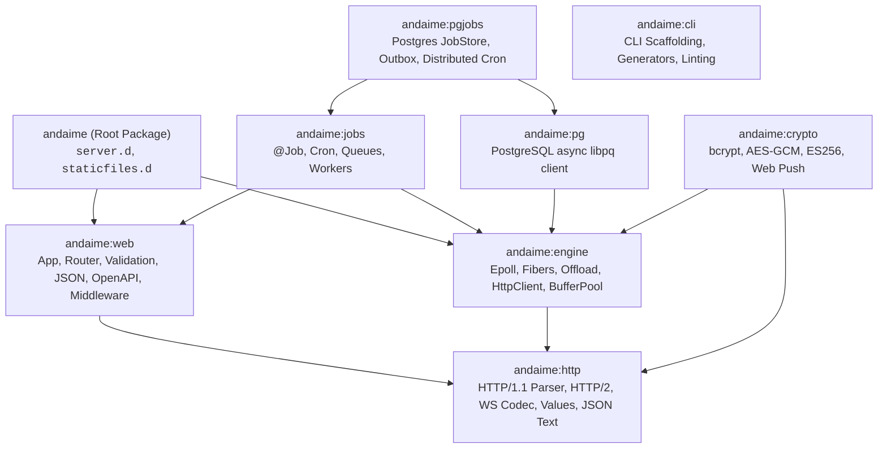
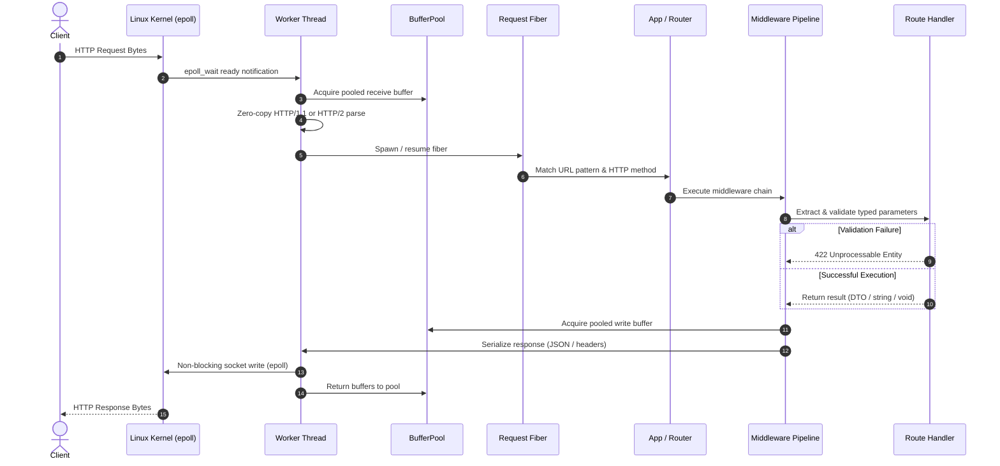

# andaime: A Comprehensive Overview

**andaime** (Portuguese for *scaffolding*; pronounced *an-DYE-mee*) is a modular, high-performance, memory-safe web framework for the D programming language (language edition 2025).

andaime brings **FastAPI-style ergonomics** to native code: your function's signature *is* its HTTP contract. Parameter extraction, type coercion, validation, dispatching, JSON serialization, and OpenAPI documentation are all synthesized **at compile time** via compile-time function execution (CTFE), `__traits`, and shallow templates. There are no schema files to maintain, no runtime reflection, and no decorators to drift out of sync.

The framework is engineered around clear performance and operational targets:
- **Fast compilation**: Under 400 ms build times on DMD for standard services.
- **Minimal resource consumption**: 15–30 MB RSS under heavy production traffic on cheap VPS instances.
- **Cooperative concurrency**: Shared-nothing multi-threaded workers (one per CPU core) running one fiber per connection on an asynchronous Linux `epoll` event loop.
- **Memory safety**: `@safe` and `-preview=dip1000` compliance across the entire core, with a GC-pooled buffer strategy that achieves zero GC allocations on the hot path after warm-up.
- **Legible compiler diagnostics**: Every invalid handler signature or dependency mismatch produces a clear, one-line `static assert` error pointing directly to the root cause.

```d
// check
@safe:

import andaime;

struct User
{
    long id;
    string name;
    Optional!string email;
}

struct CreateUserRequest
{
    @minLength(2) @maxLength(50) string name;
    Optional!string email;
}

@status(201)
User createUser(JsonBody!CreateUserRequest body_)
{
    return User(1, body_.name, body_.email);
}

App buildApp()
{
    auto app = new App;
    app.post!("/users", createUser);
    return app;
}

void main()
{
    serve(&buildApp, 8080);
}
```

---

## Table of Contents

1. [Architectural Philosophy](#1-architectural-philosophy)
2. [Package Topology & Modular Ecosystem](#2-package-topology--modular-ecosystem)
3. [The Core Paradigm: Signature as Contract](#3-the-core-paradigm-signature-as-contract)
4. [The Request-Response Lifecycle](#4-the-request-response-lifecycle)
5. [Concurrency & Fiber Execution Model](#5-concurrency--fiber-execution-model)
6. [Validation & Error Formatting](#6-validation--error-formatting)
7. [Routing, Controllers & Middleware](#7-routing-controllers--middleware)
8. [Streaming, Server-Sent Events & WebSockets](#8-streaming-server-sent-events--websockets)
9. [Database Persistence & Ambient Transactions (`andaime:pg`)](#9-database-persistence--ambient-transactions-andaimepg)
10. [Background Jobs & Distributed Scheduling (`andaime:jobs` & `andaime:pgjobs`)](#10-background-jobs--distributed-scheduling-andaimejobs--andaimepgjobs)
11. [Security, Networking & Cryptography (`andaime:crypto`)](#11-security-networking--cryptography-andaimecrypto)
12. [Application Architecture & Clean Architecture (`andaime:cli`)](#12-application-architecture--clean-architecture-andaimecli)
13. [Deterministic In-Memory Testing (`TestClient`)](#13-deterministic-in-memory-testing-testclient)
14. [Memory Model, Safety & GC Neutrality](#14-memory-model-safety--gc-neutrality)
15. [Ecosystem Reference Matrix](#15-ecosystem-reference-matrix)

---

## 1. Architectural Philosophy

Modern web development often forces a trade-off between developer velocity and runtime efficiency:
- Dynamic frameworks (FastAPI, Express, Django) offer fluid APIs and rapid prototyping, but pay heavy penalties in memory footprint, CPU overhead, and runtime type failures.
- Systems frameworks (Actix, Axum, Vibe.d) offer raw speed, but often drown application logic in verbose boilerplate, complex lifetimes, deep macro/template errors, and prolonged compilation times.

andaime eliminates this compromise by leveraging D's metaprogramming capabilities. By inspecting handler signatures during compilation, andaime generates specialized dispatchers, parsers, and validators directly into native machine code.

### Core Principles

1. **Your function signature is the contract**: If a handler needs an ID from the path, a query flag, and a validated JSON body, declare them as typed parameters. The framework ensures that by the time your function executes, all data has been parsed, converted, and validated. If validation fails, your code is never invoked.
2. **Compile-time synthesis without compile-time bloat**: Deep template recursion and heavy standard library modules (like `std.regex`, `std.json`, or `std.format`) are forbidden in the core runtime. andaime uses shallow `static foreach`, direct string manipulation, and specialized text parsers (`numparse`, `jsontext`). DMD builds remain virtually instantaneous.
3. **Shared-nothing workers, cooperative fibers**: No mutexes on the hot path. Each worker thread runs its own isolated `App` instance and handles thousands of client connections cooperatively on lightweight fibers atop `epoll`.
4. **Attach modules as needed (Scaffolding)**: `import andaime;` provides HTTP routing, JSON, fibers, and server capabilities. If your application needs a database, jobs, or cryptography, attach `andaime:pg`, `andaime:jobs`, or `andaime:crypto`. Core packages never depend on peripheral drivers.

---

## 2. Package Topology & Modular Ecosystem

andaime is organized into targeted subpackages with strictly enforced unidirectional dependencies:



### Module Responsibilities

- **`andaime:http`**: Protocol-level foundation. Completely independent of sockets and I/O. Contains the zero-copy HTTP/1.1 chunked parser, HTTP/2 session and HPACK compressor, RFC 6455 WebSocket codec, the low-overhead JSON reader/lexer (`jsontext.d`), field error tracking, and pure domain value types (`andaime.values`).
- **`andaime:web`**: High-level web application layer. Operates entirely on `Request` views and response buffers without opening sockets. Manages route registration, compile-time handler introspection, DTO validation, JSON serialization, OpenAPI 3.0 generation, RFC 9457 error formatting, CORS, cookies, streaming, and `andaime.log`.
- **`andaime:engine`**: The runtime execution machinery. Houses the Linux `epoll` event loop, cooperative fibers (`sleep`, `awaitFd`), the GC-backed byte buffer pool, a bounded threadpool (`offload`) for blocking tasks, and cooperative HTTP/WebSocket client implementations.
- **`andaime` (Root)**: The unified library glue. `import andaime;` re-exports everything required to construct and serve applications, including `serve` and static file delivery.
- **`andaime:pg`**: An independent, fully non-blocking PostgreSQL driver communicating over asynchronous `libpq` (dynamically loaded via `dlopen`).
- **`andaime:jobs`**: Background job processing framework featuring `@Job`, retry policies, deduplication, cron schedules, and process role segregation.
- **`andaime:pgjobs`**: PostgreSQL-backed job queue implementation using `FOR UPDATE SKIP LOCKED`, transactional outbox integration, and advisory-locked distributed cron.
- **`andaime:crypto`**: Cryptographic primitives wrapping OpenSSL 3's `libcrypto` and `libxcrypt` via `@safe` facades.
- **`andaime:cli`**: Standalone command-line tool providing project scaffolding (`new`), code generators (`generate`), route inspection (`routes`), OpenAPI export (`openapi`), and architectural dependency verification (`check`).

---

## 3. The Core Paradigm: Signature as Contract

In andaime, route handlers are plain functions, controller methods, or lambdas. Handler signatures explicitly declare what HTTP data they consume and return.

### Parameter Binding Rules

When registering a route, andaime analyzes the handler's parameters at compile time:

| Parameter Declaration | Inferred HTTP Source | Description |
|-----------------------|----------------------|-------------|
| Parameter matching `{name}` in route | Path segment | e.g., `/users/{id}` maps to `long id`, `string id`, or `Uuid id`. |
| Scalar argument with default value | Query string | `string filter = "active"`, `int page = 1`. |
| `Query!T` | Query string model | Struct `T` parsed from query string keys (`?name=Ana&age=30`). |
| `JsonBody!T` | Request body (JSON) | Struct or class `T` decoded from JSON with validation. |
| `Form!T` | Form body | Decodes `application/x-www-form-urlencoded` or multipart forms. |
| `UploadedFile` | Multipart file upload | Provides access to file name, content type, and body slice. |
| `Header!"Name"` | Request header | Extracted from HTTP headers (e.g., `Header!"Authorization"`). |
| `Cookie!"name"` | Request cookie | Extracted from the `Cookie` header. |
| `Context` | Low-level context | Direct access to raw request, response status, headers, and fiber storage. |

### Domain Value Types (`andaime.values`)

Domain models can use pure value types that require no I/O dependencies:
- **`Optional!T`**: Distinguishes between a missing value and a default value.
- **`PatchField!T`**: Crucial for RESTful `PATCH` operations. Captures three states:
  - *Missing*: field omitted from JSON payload.
  - *Null*: field explicitly sent as `null`.
  - *Set(value)*: field sent with a new value.
- **`JsonValue`**: A lightweight dynamic JSON node (object, array, string, number, bool, null) with bounded recursion depth (`JsonLimits.maxDepth`).
- **`Uuid`**, **`Timestamp`**, **`CalendarDate`**: Pure value abstractions for dates and unique identifiers.

### Response Conventions

Handlers convey status codes and payloads through their return types and attributes:

```d
// Returns 200 OK with application/json
User getUser(long id) { ... }

// Returns 204 No Content with empty body
void deleteUser(long id) { ... }

// Returns custom status code
@status(201)
User createUser(JsonBody!NewUser user) { ... }

// Document multiple error responses for OpenAPI
@responds(404, "User not found")
@responds(409, "Email already registered")
User findUser(string email) { ... }

// Explicit control over status, headers, and body
Response customResponse()
{
    Response res;
    res.status = 202;
    res.headers["X-Custom"] = "Value";
    res.text("Processing started");
    return res;
}
```

---

## 4. The Request-Response Lifecycle

Every HTTP request moves through a zero-allocation pipeline designed to keep latency minimal:



1. **Epoll Notification**: The worker's epoll loop detects incoming bytes on a non-blocking client socket.
2. **Zero-Copy Parsing**: The request head is parsed into a GC `NO_SCAN` buffer borrowed from the `BufferPool`. String views slice directly into the receive buffer.
3. **Fiber Scheduling**: An idle fiber is assigned to process the connection. If all fibers are busy, new connections are queued up to `ServerConfig.maxInFlight`.
4. **Routing**: The router navigates a fast radix/prefix tree to identify the matching handler.
5. **Scoped Middleware**: Application-level, group-level, and route-specific middleware execute in declaration order.
6. **Validation & Extraction**: The compile-time generated adapter reads headers, path segments, query parameters, and JSON payloads. If any validation constraint fails, a `422 Unprocessable Entity` is returned immediately without executing the handler body.
7. **Handler Execution**: The handler runs. Any I/O operation (database query, downstream HTTP call) yields the fiber back to the worker loop.
8. **Serialized Flush**: Response headers and JSON payloads are written into a pooled output buffer and written to the socket. Buffers are immediately returned to the pool for reuse.

---

## 5. Concurrency & Fiber Execution Model

andaime uses a **shared-nothing, multi-worker architecture**.

```
+-------------------------------------------------------------+
|                      Operating System                       |
|               SO_REUSEPORT (Kernel Load Balance)            |
+-------------------------------------------------------------+
        |                              |
        v                              v
+-----------------------+      +-----------------------+
|    Worker Thread 0    |      |    Worker Thread 1    |
|  (CPU Core 0 Affinity)|      |  (CPU Core 1 Affinity)|
| +-------------------+ |      | +-------------------+ |
| |    epoll Loop     | |      | |    epoll Loop     | |
| +-------------------+ |      | +-------------------+ |
| | BufferPool        | |      | | BufferPool        | |
| +-------------------+ |      | +-------------------+ |
| | Isolated App Copy | |      | | Isolated App Copy | |
| +-------------------+ |      | +-------------------+ |
|   |         |         |        |         |           |
| Fiber 1   Fiber 2 ... |      Fiber 1   Fiber 2 ...   |
+-----------------------+      +-----------------------+
```

### Shared-Nothing Workers

By default, `ServerConfig.workers = 0` initializes one worker thread per available CPU core.
- `serve(&buildApp, cfg)` invokes the `buildApp` factory **once per worker thread**.
- Each worker owns its own router, connection pools, and buffer caches.
- Threads do not share memory or lock shared mutexes, eliminating cross-core contention.

### Cooperative Fibers

Each worker thread hosts an event loop that schedules lightweight fibers:
- **`sleep(Duration)`**: Suspends only the current fiber. The worker continues serving other connections until the timer triggers.
- **`awaitFd(int fd, IoEvent events)`**: Suspends the calling fiber until the file descriptor becomes readable or writable.
- **`RequestCancelled`**: If a client disconnects or a request exceeds `requestTimeoutMs`, andaime raises a `RequestCancelled` throwable inside the fiber. Destructors and `scope(exit)` blocks unwind cleanly, while preventing cancelled requests from wasting computational resources.

### Fiber-Local Storage (`fiberLocal`)

Because multiple fibers interleave execution on a single worker thread, thread-local storage (`static` or `__gshared`) cannot be used for per-request state. andaime provides typed fiber-local storage:

```d
// Store request-specific state (e.g., current user, tenant, or transaction)
setFiberLocal!CurrentUser(user);

// Retrieve it deeper in domain logic or repositories
CurrentUser* current = fiberLocal!CurrentUser();
if (current !is null)
    log.info("Current user: ", current.id);

// Automatically cleared when the fiber completes
clearFiberLocal!CurrentUser();
```

### Offloading Blocking Work (`offload`)

Synchronous operations—such as legacy C libraries, CPU-intensive password hashing, or blocking DNS lookups (`getaddrinfo`)—must never block the worker thread. The `offload` utility delegates tasks to a bounded background threadpool:

```d
// Runs computation on background threadpool; fiber yields cooperatively
auto hash = offload(() => computeHeavyHash(data));
```

If the background queue is saturated, `offload` immediately raises `PoolSaturated`, allowing the application to respond with `503 Service Unavailable` rather than degrading worker responsiveness.

---

## 6. Validation & Error Formatting

Input validation in andaime is declarative. Validation annotations placed directly on struct fields are enforced prior to handler invocation:

```d
struct CreateProduct
{
    @minLength(3) @maxLength(100)
    string title;

    @inRange(1, 100_000)
    int priceCents;

    @optional @maxLength(500)
    string description;
}
```

### Validation Annotations

- `@minLength(n)`, `@maxLength(n)`: Enforce string and slice length bounds.
- `@inRange(min, max)`: Enforce numeric intervals (inclusive).
- `@strict`: Reject JSON objects containing unexpected or unregistered keys.
- `@jsonKey("wire_name")`: Map between external API names and internal identifier conventions.
- `@jsonIgnore`: Exclude sensitive fields from serialization.
- `@omitIfAbsent`: Omit field from JSON serialization when holding default/empty state.
- `@naming(Naming.snakeCase)`: Set casing strategy for an entire struct or controller.

### Error Responses & RFC 9457

When validation fails, andaime responds with `422 Unprocessable Entity` containing structured error details:

```json
{
  "errors": [
    {
      "loc": ["body", "title"],
      "type": "string_too_short",
      "msg": "must be at least 3 characters"
    }
  ]
}
```

You can customize error handling application-wide or adopt RFC 9457 Problem Details:

```d
app.errorBody((ref const ErrorInfo err) => ProblemDetails(
    type: "https://example.com/errors/" ~ err.code,
    title: err.message,
    status: err.status
));
```

---

## 7. Routing, Controllers & Middleware

### Functional & Controller Routing

Routes can be registered via functional methods or organized into class-based controllers:

```d
// Functional registration
app.get!("/items", listItems);
app.post!("/items", createItem);

// Grouping with shared prefixes
auto api = app.group("/api/v1");
api.get!("/status", getStatus);

// Class-based controller mounting
final class UsersController
{
    @Get("/users")
    User[] list() { ... }

    @Get("/users/{id}")
    User get(long id) { ... }
}

app.mount(new UsersController);
```

### Middleware Architecture

Middleware functions wrap the execution pipeline using a clean onion-model design:

```d
void timingMiddleware(Context ctx, Next next)
{
    MonoTime start = MonoTime.currTime;
    next(ctx); // Pass control down the pipeline
    Duration elapsed = MonoTime.currTime - start;
    ctx.response.headers["X-Response-Time-Ms"] = itoa(elapsed.total!"msecs");
}

app.use(&timingMiddleware);
```

Middleware can be applied:
- Globally: `app.use(&myMiddleware)`
- To groups: `group.use(&authMiddleware)`
- To marked routes: `group.use!RequiresAdmin(&adminMiddleware)`

---

## 8. Streaming, Server-Sent Events & WebSockets

### Chunked Streaming & Server-Sent Events

For large payloads or live progress feeds, handlers can return `Stream` or `EventStream`:

```d
// Stream chunks of text or binary data
Stream streamData()
{
    return (StreamWriter writer) {
        foreach (i; 0 .. 10)
        {
            writer.write("chunk data\n");
            sleep(100.msecs); // Non-blocking fiber sleep
        }
    };
}

// Server-Sent Events (SSE)
EventStream liveUpdates()
{
    return (EventWriter events) {
        events.event("ping", "server time");
    };
}
```

The underlying pipeline applies cooperative backpressure: if a client reads slowly, `writer.write` suspends the fiber when output buffers cross `streamHighWaterBytes`.

### WebSockets

andaime provides first-class WebSocket support (RFC 6455) with optional `permessage-deflate` compression and HTTP/2 stream tunneling (RFC 8441):

```d
WebSocket chatEndpoint()
{
    return (WsConn conn) {
        while (conn.isOpen)
        {
            WsMessage msg = conn.receive();
            if (msg.kind == WsKind.text)
                conn.send("Echo: " ~ msg.text);
        }
    };
}

app.ws!("/ws/chat", chatEndpoint);
```

---

## 9. Database Persistence & Ambient Transactions (`andaime:pg`)

`andaime:pg` is a cooperative, zero-dependency PostgreSQL driver implemented directly over asynchronous `libpq`.

```d
auto db = pgPool("host=localhost dbname=app user=postgres");

// Parameterized queries are safe against SQL injection
PgResult res = db.query("SELECT id, name, email FROM users WHERE id = $1", userId);

// Map database columns directly to D structs
User[] users = res.rowsAs!User();
```

### Ambient Transactions

Transactions can be scoped to the active fiber without manually passing connection handles across architectural boundaries:

```d
db.transaction((PgConn tx) {
    tx.exec("UPDATE accounts SET balance = balance - 100 WHERE id = 1");
    tx.exec("UPDATE accounts SET balance = balance + 100 WHERE id = 2");
    // Automatically commits on normal exit; rolls back on thrown exception
});
```

---

## 10. Background Jobs & Distributed Scheduling (`andaime:jobs` & `andaime:pgjobs`)

Background processing is decoupled from request-handling fibers via `andaime:jobs`.

```d
@Job("emails")
@Retry(3, BackoffStrategy.exponential)
@UniqueJob(10.minutes)
struct SendWelcomeEmail
{
    long userId;
    string email;

    void perform(JobContext ctx)
    {
        // Executes asynchronously on background worker
    }
}
```

### The Transactional Outbox Pattern

`andaime:pgjobs` prevents data inconsistency between your primary database and job queues by enqueuing jobs within the active PostgreSQL transaction using `FOR UPDATE SKIP LOCKED`:

```d
db.transaction((tx) {
    userRepo.save(tx, newUser);
    // Enqueued within the same PostgreSQL transaction
    enqueueJob(tx, store, SendWelcomeEmail(newUser.id, newUser.email));
});
// If the transaction fails, both user creation and job enqueue roll back atomically.
```

### Distributed Cron

Cron tasks are defined with standard cron expressions:

```d
@Job("maintenance")
@Cron("0 3 * * *") // Runs every night at 3:00 AM
struct DailyCleanupJob
{
    void perform(JobContext ctx) { ... }
}
```

When multiple process replicas run concurrently, `andaime:pgjobs` uses PostgreSQL advisory locks to guarantee that each scheduled cron slot is claimed and executed by exactly one worker instance.

---

## 11. Security, Networking & Cryptography (`andaime:crypto`)

### Dynamic OpenSSL Integration

`andaime:crypto` provides `@safe` cryptographic primitives over OpenSSL 3 (`libcrypto`) without requiring static linking:
- **Password Hashing**: `bcryptHash` and `bcryptVerify` (with cooperative `bcryptHashOffload` to prevent loop stalling).
- **Symmetric Encryption**: `aes128GcmSeal` and `aes128GcmOpen` (Authenticated Encryption with Associated Data - AEAD).
- **Asymmetric Signing**: NIST P-256 ECDSA (`es256Sign`, `es256Verify`) for JSON Web Signatures (JWS).
- **Key Exchange**: P-256 ECDH (`ecdhP256`).
- **Web Push**: Full RFC 8291 payload encryption (`webPushEncrypt`).

### Production TLS & Zero-Downtime Reloads

andaime's TLS engine supports live certificate reloading. When certificates update (e.g., via Let's Encrypt / Certbot), the server reloads key material without dropping existing client connections or restarting the process:

```d
ServerConfig cfg;
cfg.tls.certFile = "/etc/letsencrypt/live/api.example.com/fullchain.pem";
cfg.tls.keyFile  = "/etc/letsencrypt/live/api.example.com/privkey.pem";
cfg.tls.reloadCheckMs = 3600_000; // Check for updated certificates hourly
cfg.tls.redirectPort  = 80;       // Automatically redirect HTTP to HTTPS
serve(&buildApp, cfg);
```

---

## 12. Application Architecture & Clean Architecture (`andaime:cli`)

andaime does not force a specific folder structure on simple applications (`examples/hello` is a single file). However, for applications destined to grow, `andaime new` provides an opinionated **Clean Architecture** template:

```
source/
  domain/                 // Business rules, entities (Zero framework dependencies)
  usecases/               // Application use cases and port interfaces
  adapters/
    http/                 // HTTP controllers, request/response DTOs
    postgres/             // Database repositories implementing usecase ports
    memory/               // In-memory repository mocks for rapid testing
    jobs/                 // Background job implementations
  app.d                   // Composition root (DI wiring and routing)
  main.d                  // Entrypoint and server configuration
```

### Compile-Time Dependency Injection (`construct!T`)

Rather than relying on reflection or runtime service locators, andaime resolves dependency graphs at compile time using `construct!T`:

```d
struct Adapters
{
    UserRepository users;
    EmailService emailer;
    Clock clock;
}

// Automatically matches constructor parameters to adapter fields
auto controller = construct!UserController(adapters);
```

### Architectural Linting (`andaime check`)

The CLI includes an architectural verification tool:
```sh
andaime check
```
`andaime check` inspects the D compiler's import graph to ensure that inner layers (such as `domain/` and `usecases/`) never import outer adapters or framework infrastructure.

---

## 13. Deterministic In-Memory Testing (`TestClient`)

Integration tests should be fast, reliable, and run without socket overhead or port collisions. `TestClient` executes full HTTP requests directly in-memory against your `App`:

```d
unittest
{
    auto app = buildApp();
    auto client = new TestClient(app);

    // Make an in-memory GET request
    auto res = client.get("/users/1");
    assert(res.status == 200);
    assert(res.json["name"].str == "Ana");

    // Test JSON POST with cookie jar support
    client.followCookies = true;
    auto createRes = client.postJson("/users", `{"name":"Bob"}`);
    assert(createRes.status == 201);
}
```

External HTTP calls can be mocked using `FakeHttpClient`, while background queues can be tested synchronously via `JobTestQueue`.

---

## 14. Memory Model, Safety & GC Neutrality

### Safe Memory Model

All framework internals are written in `@safe` D. User handlers default to `@safe`, but may use `@system` functions if interfacing with legacy C bindings. Compiling with `-version=AndaimeStrictSafe` strictly forbids any `@system` handlers across the codebase.

The memory model guarantees safety through deliberate buffer lifecycle management:
- Slices read internally by the parser point into GC-allocated memory marked `NO_SCAN`.
- Buffers are retained in a thread-local pool for reuse across successive requests.
- Handler signatures, DTOs (`JsonBody!T`, `Query!T`, `Form!T`, `UploadedFile`), headers, cookies, and text types with indirections always receive isolated heap copies (`.idup`), eliminating cross-request data bleeding. Only explicit low-level inspection of `ctx.request.*` and `ctx.cookie(...)` provides raw buffer views.

### Hot-Path GC Neutrality

Once worker connection pools and buffer caches have warmed up, processing standard JSON request-response cycles generates **zero garbage collector allocations**. Memory footprint stays completely flat (typically 15–30 MB RSS), preventing GC pauses under high-throughput workloads.

---

## 15. Ecosystem Reference Matrix

| Package | DUB Name | Primary Responsibility | Dependencies |
|---------|----------|------------------------|--------------|
| **`andaime`** | `andaime` | Framework entrypoint (`serve`, `staticfiles`) | `andaime:web`, `andaime:engine` |
| **`andaime:web`** | `andaime:web` | Routing, DTO validation, JSON, OpenAPI, context | `andaime:http` |
| **`andaime:engine`** | `andaime:engine` | epoll event loop, fibers, buffer pool, offload, HTTP client | `andaime:http` |
| **`andaime:http`** | `andaime:http` | HTTP/1.1, HTTP/2, WebSocket codecs, value types | *None* |
| **`andaime:pg`** | `andaime:pg` | Non-blocking async PostgreSQL client | `andaime:engine` |
| **`andaime:jobs`** | `andaime:jobs` | Background jobs, retries, cron scheduling | `andaime:web`, `andaime:engine` |
| **`andaime:pgjobs`** | `andaime:pgjobs` | PostgreSQL-backed job queue, transactional outbox | `andaime:jobs`, `andaime:pg` |
| **`andaime:crypto`** | `andaime:crypto` | bcrypt, AES-GCM, P-256 ECDSA, Web Push | `andaime:http`, `andaime:engine` |
| **`andaime:cli`** | `andaime:cli` | Scaffolding, code generators, route tables, linting | *Independent tool* |

---

## Summary & Next Steps

andaime proves that you don't have to sacrifice simplicity or developer experience to achieve native performance. By treating function signatures as contracts and executing type validation at compile time, andaime provides a robust, productive, and resource-conscious foundation for web services.

- Explore the step-by-step tutorial: [Getting started](getting-started.md)
- Learn about Clean Architecture in D: [Architecture guide](architecture.md)
- Understand the fiber concurrency engine: [Concurrency reference](concurrency.md)
- Read the configuration manual: [Configuration reference](configuration.md)
